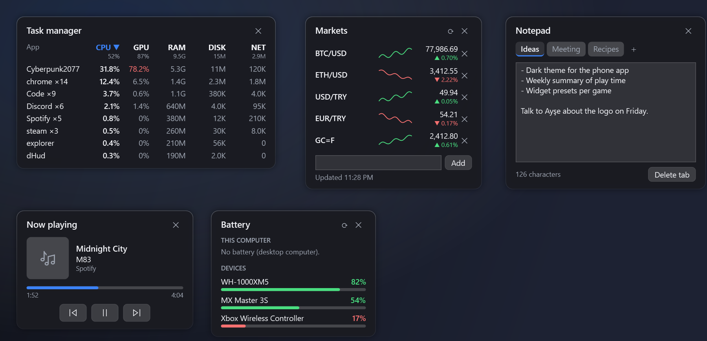
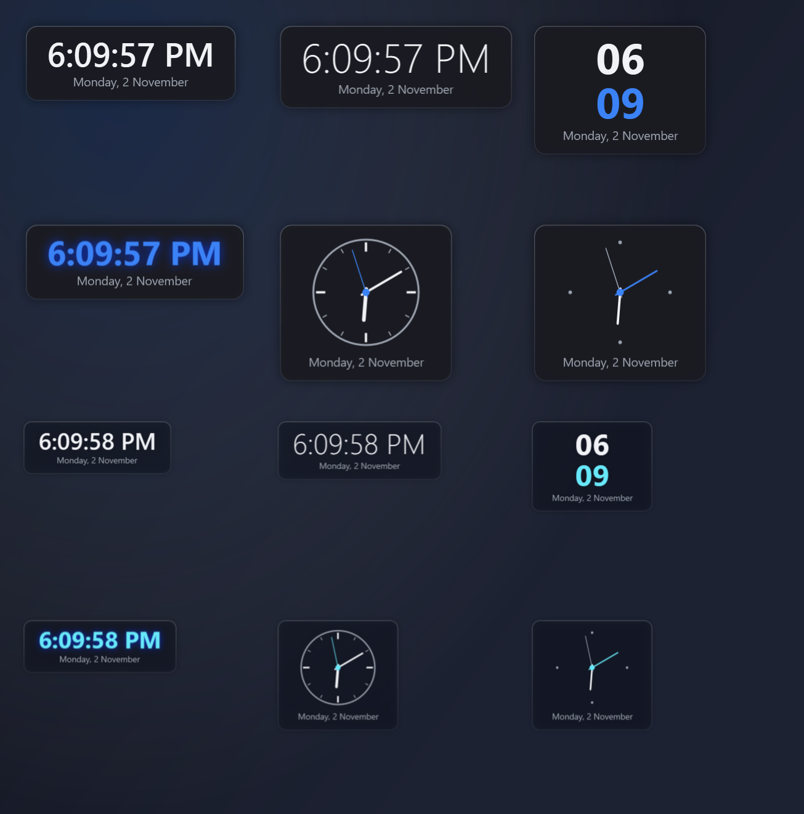

  

<h1 align="center">dHud</h1>

A light, transparent hardware overlay for Windows, with desktop widgets, fan control, a game FPS counter and an Android app.

<b>English</b> · <a href="README.tr.md">Türkçe</a>

  

## What is dHud?

- **A thin bar** at the top of your screen with CPU / GPU temperature, usage, clocks, fans, RAM, network and ping.
- **Desktop widgets** (all optional): clock, sticky notes, to-do list, timer, weather, calendar, system summary and more.
- **Extras when you want them:** fan control, a game FPS counter and an Android app for your phone or tablet.

It is easy on your PC (low CPU and memory use), has no telemetry and is free ([MIT](LICENSE)).

## Quick start

1. Download the installer from the [latest release](https://github.com/d0ukan/dHud-xverlay/releases/latest) and run it.
2. Start dHud. The bar appears: drag it where you like.
3. Click the ⚙ on the bar (or double-click the tray icon) to open **Settings**. The search box at the top finds any setting.

> CPU temperature needs **administrator rights** and the free [PawnIO](https://pawnio.eu) driver. Settings tells you if either is missing.

## What can it do?

| | |
| --- | --- |
| **The bar** | Live values in a slim bar. Vertical or horizontal, compact mode, click-through, hotkeys. You can also turn it off. |
| **Widgets** | Small dark cards you drag onto a grid. 12 kinds, each with its own options. |
| **Profiles** | Save all your settings under a name, switch in one click, move everything to a new PC. |
| **Fan control** | Draw your own fan curves, use presets, test fans. Safe by design. |
| **Game FPS** | FPS counter and an end-of-game summary. |
| **Android app** | See everything on your phone or tablet, get alerts, even change fan presets. |

The details are below. Open what you need.

<b>The bar and shortcuts</b>

 

Each row can show temperature (green / yellow / red by your thresholds), usage, clock, power, fan speed and a tiny graph. Rows: **CPU**, **GPU**, **RAM**, **NET** (download, upload, ping), plus optional **DISK** and **CORE** (busiest CPU core). Right-click the bar → **Metrics** to switch items on or off.

| Action | How |
| --- | --- |
| Move the bar | Drag it (it stays on screen and snaps to edges) |
| Open Settings | ⚙ on the bar, right-click → Settings, or double-click the tray icon |
| Hide / show the bar | `Ctrl` + `Shift` + `F9`, or right-click → **Turn off the bar** |
| Click-through on / off | `Ctrl` + `Shift` + `F10` |
| Quick menu | Right-click the bar |

The bar is optional: if you prefer the **System** widget (same values), turn the bar off in Settings → Appearance and bring it back any time from the tray icon.

> The bar and widgets cannot appear over *exclusive* fullscreen games. Use borderless / windowed-fullscreen mode.

<b>Widgets</b>

 

*Settings → Widgets.* Every widget is a small card with an on/off switch; **Options** opens its visibility, always-on-top, lock and "move to corner" buttons. Widgets snap to a fine grid like macOS desktop widgets: while you drag, the spot it will take is highlighted. Drag any **edge or corner** to resize a widget: it snaps to whole grid cells, so cards line up like puzzle pieces, and the content grows and shrinks with the card (lists get wider text and show more rows, clocks and gauges scale proportionally). A widget can't be made smaller than its normal size, so text and gauges stay readable; you can only make it larger. Edges also snap to the edges of neighbouring widgets (a thin blue guide line shows the alignment), both while resizing and when you drop a widget; hold **Alt** to switch that off. Double-click an edge to go back to the automatic size. They never overlap each other or the bar and can't be dragged off-screen. All are off by default and use almost no CPU.

**Closing a widget closes its gap:** when you hide a widget, the widgets below it slide up into its place; when you show it again from Settings, they all go back where they were. A widget you moved yourself in between stays where you put it. You can turn this off at the top of *Settings → Widgets*.

**Colour themes:** pick one of nine (Graphite, Midnight, Forest, Wine, Violet, Amber, Teal, a see-through Glass theme and a Light theme) at the top of *Settings → Widgets*. It changes the card and accent colour of all widgets at once; sticky notes keep their own colours.

**Widget size:** the *Widget size* slider (50–100 %) under the themes shrinks every widget together, handy on large or high-resolution screens where the widgets cover too much of the desktop. It scales automatic and resized cards alike.

**Full-screen apps:** while a film, presentation or game is running full screen, the widgets hide themselves and come back when you leave (*Settings → Behavior → Full-screen apps*). The top bar stays by default so you can still watch temperatures in games; tick *Hide the top bar too* if you want it hidden as well.

| Widget | What it does |
| --- | --- |
| **Clock** | Time and date in six looks (digital, minimal, stacked, glow, analog, analog minimal) – hover the card and use the ‹ › arrows or right-click → Clock style. Optional seconds and a second time zone. |
| **Sticky notes** | Up to 30 notes stacked like **folder tabs**: click a tab to bring it forward, drag a tab to move the stack. Saved as you type. |
| **To-do list** | Add a task with Enter, add sub-tasks with ＋, tick it off, clear the finished ones. Right-click a task to duplicate it with its sub-tasks or copy it as text. |
| **Timer and reminders** | Quick timers, reminders at a clock time and a pomodoro. Notification and sound (optionally on your phone). |
| **Stopwatch** | Start, pause, laps. |
| **Day counter** | "12 days left" for any date. |
| **Calendar** | The next 7 days from an `.ics` file or link (repeating events work). No account sign-in. |
| **Weather** | Current weather and a 3-day forecast for your city. Uses the internet (as do Markets and a calendar link); off until you pick a city. |
| **System summary** | CPU, GPU, VRAM, RAM, disk and network on bars. |
| **Quick launcher** | Your favourite apps and files as icons (opened without administrator rights). |
| **Clipboard history** | The last 10 copied items: texts and, if you like, images such as screenshots (a small preview; click to copy it again; at most 5 images, about 60 MB). Kept in memory only, never saved to disk; password managers' private copies are skipped. Images can be turned off in the widget's settings. |
| **Sound and microphone** | Volume, mute and microphone mute. |
| **Media player** | The track that is playing (any app: Spotify, browser, VLC...) with cover, progress and previous / play-pause / next buttons. Uses Windows' own media controls. |
| **Task manager** | A simple version: which app uses how much **CPU, RAM, disk and internet**. Processes of the same app (a browser's many tabs) are summed in one row; click a column to sort. The internet column needs dHud to run as administrator. |
| **Markets** | Crypto, stocks and currencies (`BTC-USD`, `AAPL`, `THYAO.IS`, `USDTRY=X`, `GC=F`) with the daily change and a tiny day chart. You choose the symbols. Uses the internet (Yahoo Finance) only while visible; prices can be delayed. |
| **Battery and devices** | Laptop battery with charging state and time left, plus the battery of Bluetooth headsets, mice, keyboards and controllers that report it to Windows. |
| **Notepad** | A notepad with tabs for longer texts (up to 12 tabs). Click a tab to open it, double-click to rename. Saved as you type. |

Notes and lists are stored only on your PC in `%AppData%\dHud\widgets.json` (saved safely, with a `.bak` copy).

<b>Profiles and moving to a new PC</b>

 

*Settings → Profiles.*

- **Profiles:** save all your settings (look, metrics, widgets, alerts, fan curves …) under a name and switch with one click, also from the tray icon.
- **Back up / move:** *Export everything…* writes one `.dhudprofile` file. On the new PC install dHud, choose *Import…* and carry on where you left off. You can include your notes, lists and launcher items, and optionally the phone pairing key.
- **Safe:** importing never turns fan control on by itself, and the phone key is only taken if you tick it. Launcher paths and fan sensors belong to the old PC, so check them after moving.

<b>Fan control</b>

 

*Settings → Behavior → Fan control* (needs administrator rights). dHud lists every fan it can control. For each one choose **Auto** (dHud does not touch it), **Manual** (fixed speed) or **Curve** (speed follows temperature: drag points, click to add, right-click to remove).

- **Presets:** *Quiet*, *Optimal*, *Max Cold*. Apply one to all fans at once (pumps are skipped unless you ask). CPU, GPU and case fans get their own curve: in *Quiet* and *Optimal* the graphics card and case fans start from a warmer point and reach 100% a little later (at 87 °C instead of 85 °C), because they tolerate more heat. *Max Cold* is the same for all. The emergency 100% rule still applies.
- **Your own curves and profiles:** save a curve under a name, or the setup of all fans as a profile.
- **Test:** runs a fan at 100% for a few seconds to see if it really responds.
- **Alerts:** if a controlled fan stops, you get one calm notification (also on your phone). It can be turned off.

**Safety:** fan control is off by default and asks for confirmation. If CPU or GPU gets critically hot, or a temperature sensor is lost, every controlled fan goes to 100%. Fans slow down gradually. When dHud exits or crashes, fans are handed back to the BIOS. If dHud is killed abruptly, a tiny windowless helper sets those fans to a safe 70% and dHud tells you at the next start. Not every motherboard allows software fan control.

<b>Game FPS counter</b>

 

*Settings → Behavior → Game FPS* (off by default, needs administrator rights). Measures the FPS of the fullscreen / borderless game in front without injecting anything into it, shows a small counter in the corner and on your Android app. When a session of 2+ minutes ends, a summary card shows average FPS, 1% low, lowest / highest FPS and peak temperatures. Works with DirectX 10 / 11 / 12 (DirectX 9 is experimental; Vulkan and OpenGL are not measured).

<b>Android app</b>

 

Mirrors dHud on your **local network** (same Wi-Fi), in the same dark theme.

1. Download `dHud-<version>.apk` from the [latest release](https://github.com/d0ukan/dHud-xverlay/releases/latest) onto the phone / tablet and install it.
2. On the PC: *Settings → Behavior → Mobile app* → tick **Allow the dHud mobile app to connect**. A QR code appears (allow Windows Firewall on private networks).
3. In the app tap **Scan QR code**. The dot at the top turns green.

It shows live values and a temperature graph, vibrates and notifies on alerts, shows which fan preset is active next to CPU and GPU, shows your reminders and the game summary, and has a **full-screen dashboard** for tablets (it slowly shifts and dims to protect the screen) and a **home-screen widget**. It finds your PC again if its IP address changes and updates itself with one tap.

**Widgets from the phone:** a *Widgets* tab shows live cards of your PC's widgets, handy on a tablet next to your desk: a **media player** (cover, progress, previous / play-pause / next), your **launcher** (tap an app and it opens on the PC), the **clipboard history** (tap a text to copy it to the phone; a button sends the phone's clipboard to the PC), your **to-dos**, a **task manager** (which app uses how much CPU, RAM, disk and, if dHud runs as administrator, internet), **markets** and **battery** (PC and Bluetooth devices). The PC only sends this data while the tab is open. On by default; switch it off with **Let the mobile app show and use widgets**. The phone can only open apps you added to the launcher and cannot run anything else. Cards for widgets that are off on the PC (Clipboard, Markets) tell you so.

**Always in step:** the PC tells the phone which dHud version it runs. When the PC is newer, the app checks for an update at once and offers it with one tap (Android always asks you to confirm the install). Releases build the PC and the phone app from the same version number.

**Tasks from the phone:** a *Tasks* tab lists your PC's to-do list. Add tasks and sub-tasks, tick or delete them, and set a reminder in a few taps; it shows up on your PC at once and rings there (and on the phone if you enabled reminders to phone). On by default; switch it off with **Let the mobile app manage to-dos and reminders**. The phone never sees your sticky notes; it sees the clipboard history only on the Widgets tab, and only if you leave that option on.

**Home-screen widget sizes:** make it one row tall for just CPU and GPU temperatures, two rows for temperatures and FPS, three or more rows to also see load percentages and RAM and disk bars.

**Fans from the phone:** a separate *Fans* tab. Off by default: tick **Let the mobile app change fan settings** on the PC. The phone can only pick ready-made options (Auto, Quiet / Optimal / Max Cold, your saved curves, a saved profile) and switch fan control on or off. Each fan has an **Allow control from phone** checkbox on the PC, and all safety rules still apply.

Only paired devices can connect; nothing leaves your network. Ports: TCP `47821`, UDP `47822`.

## Installation

Get these from the [latest release](https://github.com/d0ukan/dHud-xverlay/releases/latest):

- **`dHud-Setup-<version>.exe`**: installer (per user, no admin rights needed, adds a Start menu entry).
- **`dHud-<version>.exe`**: portable single file.
- **`dHud-<version>.apk`**: Android app.

dHud checks GitHub for new versions and updates with one click. **Requirements:** Windows 10 / 11 (no .NET install needed), Android 7.0+.

> The app is not code-signed yet, so Windows SmartScreen may warn you the first time: **More info → Run anyway**.

## Troubleshooting

| Problem | Fix |
| --- | --- |
| CPU temperature shows `--` | Run as administrator and install the [PawnIO](https://pawnio.eu) driver. |
| Bar missing in a game | Switch the game to borderless / windowed-fullscreen. |
| Fan list is empty | Run as administrator. Some motherboards don't allow software fan control. |
| FPS shows nothing | Turn on *Game FPS*, run as administrator, use a fullscreen / borderless DirectX game. |
| Phone can't connect | Same Wi-Fi? *Mobile app* ticked? Allow dHud in Windows Firewall (private network). Try *Reset pairing*. |
| Widgets or bar off-screen | Right-click → Reset position, or use *Move to* in Settings → Widgets. |
| Something else | Settings → Behavior → **Help → Copy diagnostic info** and paste it into your report. |

## Privacy

No telemetry. The only internet requests are the update check to GitHub and, only if you turn on those widgets, the weather lookup at open-meteo.com (the city you search for and its coordinates; no account, no key), a calendar link you entered, or the prices of the symbols you add to the Markets widget (Yahoo Finance; only the symbols are sent). The phone connection stays on your local network and needs the pairing key.

## Credits and license

[MIT](LICENSE) © 2026 d0ukan. Sensors are read with [LibreHardwareMonitor](https://github.com/LibreHardwareMonitor/LibreHardwareMonitor) (MPL-2.0); FPS with Windows event tracing ([TraceEvent](https://github.com/microsoft/perfview), MIT); audio with [NAudio](https://github.com/naudio/NAudio) (MIT).
