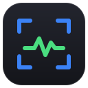
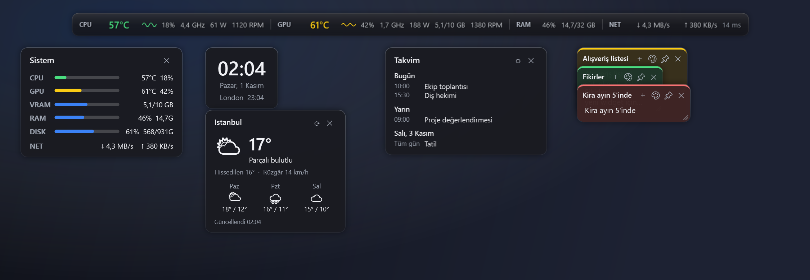
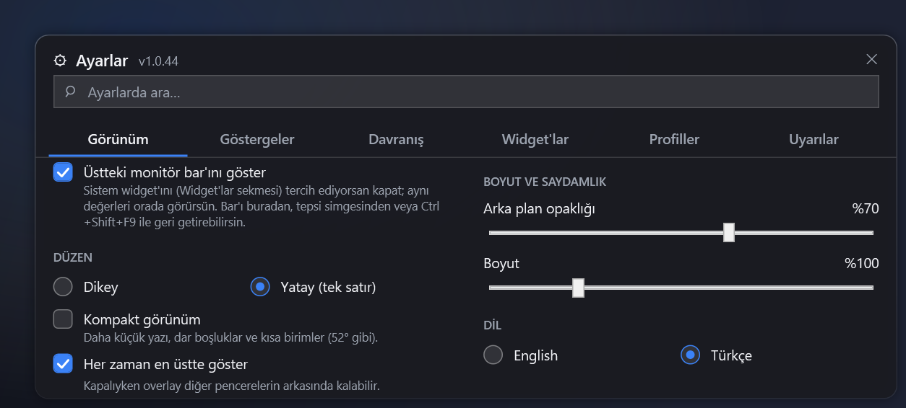
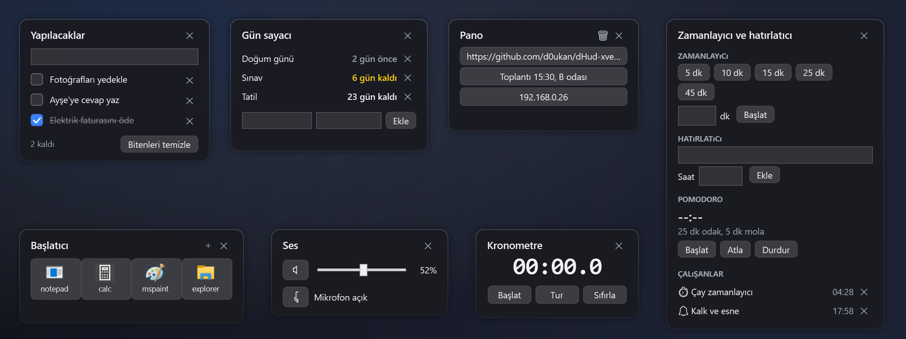
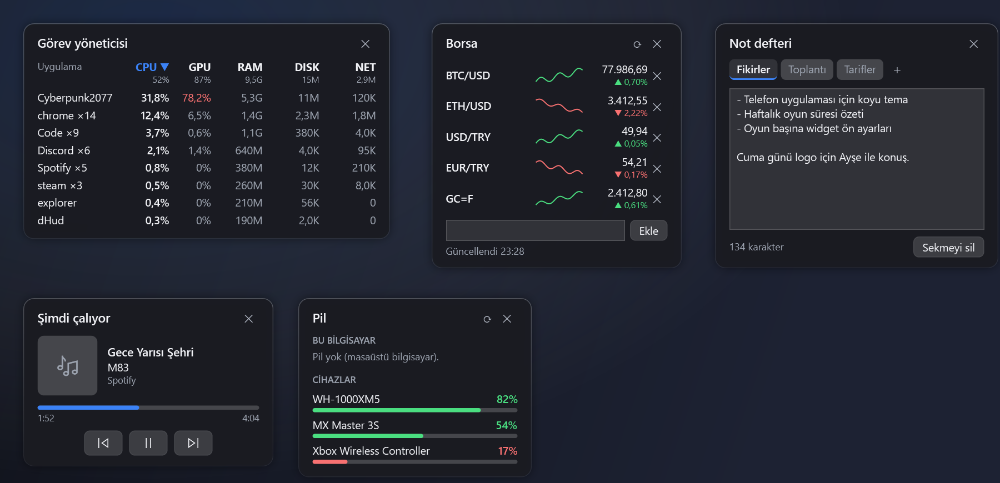
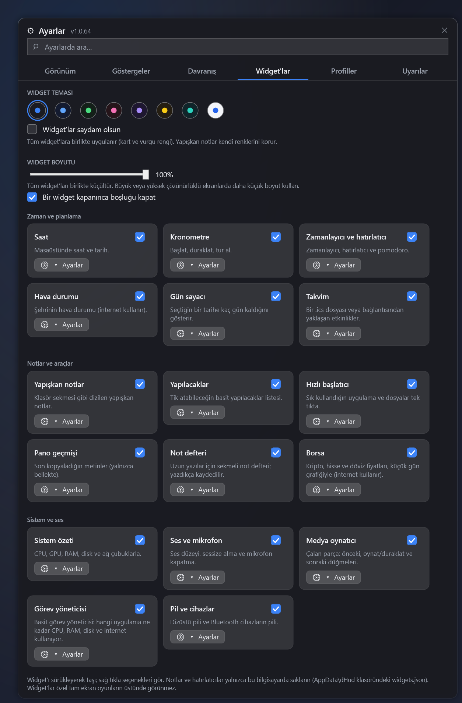
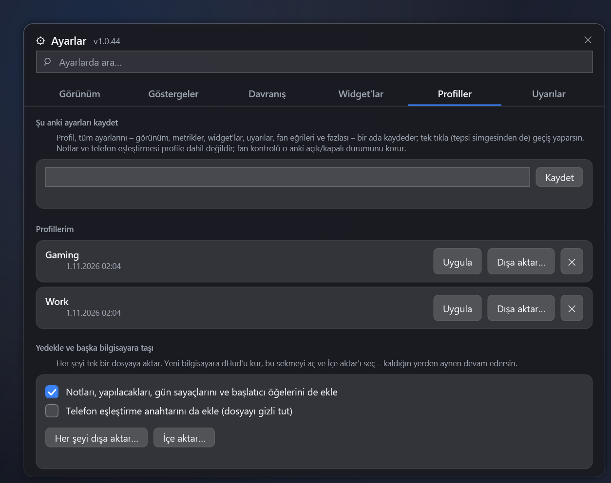

  

<h1 align="center">dHud</h1>

Windows için hafif, şeffaf bir donanım göstergesi; masaüstü widget'ları, fan kontrolü, oyun FPS sayacı ve Android uygulaması ile.

<a href="README.md">English</a> · <b>Türkçe</b>

  

## dHud nedir?

- **İnce bir bar:** ekranının üstünde CPU / GPU sıcaklığı, kullanım, frekans, fanlar, RAM, ağ ve ping.
- **Masaüstü widget'ları** (hepsi isteğe bağlı): saat, yapışkan not, yapılacaklar, zamanlayıcı, hava durumu, takvim, sistem özeti ve fazlası.
- **İstediğinde ekstralar:** fan kontrolü, oyun FPS sayacı ve telefonun veya tabletin için Android uygulaması.

Bilgisayarını yormaz (düşük CPU ve bellek kullanımı), telemetri yoktur ve ücretsizdir ([MIT](LICENSE)).

## Hızlı başlangıç

1. [Son sürümden](https://github.com/d0ukan/dHud-xverlay/releases/latest) kurulum dosyasını indir ve çalıştır.
2. dHud'u aç. Bar görünür: istediğin yere sürükle.
3. Bardaki ⚙'ye tıkla (veya tepsi simgesine çift tıkla) ve **Ayarlar**'ı aç. Üstteki arama kutusu her ayarı bulur.

> CPU sıcaklığı için **yönetici yetkisi** ve ücretsiz [PawnIO](https://pawnio.eu) sürücüsü gerekir. Ayarlar, ikisinden biri eksikse söyler.

## Neler yapabilir?

| | |
| --- | --- |
| **Bar** | İnce bir barda canlı değerler. Dikey veya yatay, kompakt mod, tıklama geçirme, kısayollar. İstersen kapatabilirsin. |
| **Widget'lar** | Izgaraya oturan küçük koyu kartlar. 12 çeşit, her birinin kendi ayarları var. |
| **Profiller** | Tüm ayarlarını bir ada kaydet, tek tıkla geç, her şeyi yeni bilgisayara taşı. |
| **Fan kontrolü** | Kendi fan eğrilerini çiz, hazır ayarları kullan, fanları test et. Güvenli tasarım. |
| **Oyun FPS** | FPS sayacı ve oyun sonu özeti. |
| **Android uygulaması** | Her şeyi telefonunda veya tabletinde gör, uyarı al, hatta fan hazır ayarlarını değiştir. |

Ayrıntılar aşağıda. İhtiyacın olanı aç.

<b>Bar ve kısayollar</b>

 

Her satır sıcaklığı (eşiklerine göre yeşil / sarı / kırmızı), kullanımı, frekansı, gücü, fan hızını ve küçük bir grafiği gösterebilir. Satırlar: **CPU**, **GPU**, **RAM**, **NET** (indirme, yükleme, ping) ve isteğe bağlı **DISK** ile **CORE** (en yoğun CPU çekirdeği). Barda sağ tık → **Metrics** ile öğeleri açıp kapatırsın.

| İşlem | Nasıl |
| --- | --- |
| Barı taşı | Sürükle (ekranda kalır, kenarlara yapışır) |
| Ayarları aç | Bardaki ⚙, sağ tık → Ayarlar veya tepsi simgesine çift tık |
| Barı gizle / göster | `Ctrl` + `Shift` + `F9` veya sağ tık → **Bar'ı kapat** |
| Tıklama geçirme aç / kapa | `Ctrl` + `Shift` + `F10` |
| Hızlı menü | Barda sağ tık |

Bar isteğe bağlıdır: aynı değerleri gösteren **Sistem** widget'ını tercih edersen Ayarlar → Görünüm'den barı kapat; istediğin zaman tepsi simgesinden geri getirirsin.

> Bar ve widget'lar *özel* tam ekran (exclusive fullscreen) oyunların üstünde görünemez. Oyunu kenarlıksız / pencereli tam ekran moduna al.

<b>Widget'lar</b>

 

*Ayarlar → Widget'lar.* Her widget, aç/kapat anahtarı olan küçük bir karttır; **Ayarlar** düğmesi görünürlük, hep üstte, kilit ve "köşeye taşı" düğmelerini açar. Widget'lar macOS masaüstü widget'ları gibi ince bir ızgaraya oturur: sürüklerken oturacağı yer vurgulanır. Bir widget'ı **kenarından veya köşesinden** çekerek boyutlandırabilirsin: boyut ızgara hücrelerine oturur, kartlar puzzle parçaları gibi yan yana dizilir; içerik de karta göre büyür ve küçülür (listelerde yazı büyür ve daha çok satır görünür, saat ve göstergeler orantılı ölçeklenir). Bir widget normal boyutundan küçültülemez, böylece yazılar ve göstergeler okunur kalır; yalnızca büyütebilirsin. Kenarlar ayrıca komşu widget'ların kenarlarına yapışır (hizayı ince mavi bir kılavuz çizgi gösterir); hem boyutlandırırken hem widget'ı bırakırken geçerlidir, **Alt** tuşuna basılıyken kapanır. Kenara çift tıklayınca otomatik boyuta dönersin. Birbirinin ve barın üstüne binmez, ekranın dışına çıkarılamaz. Hepsi varsayılan kapalıdır ve neredeyse hiç CPU kullanmaz.

**Widget kapanınca boşluk kapanır:** bir widget'ı kapattığında altındakiler yukarı kayıp yerini doldurur; *Ayarlar*'dan geri açınca hepsi eski yerine döner. Bu arada kendin taşıdığın bir widget bıraktığın yerde kalır. *Ayarlar → Widget'lar* sayfasının üstünden kapatabilirsin.

**Renk temaları:** *Ayarlar → Widget'lar* sayfasının üstünden sekiz temadan birini seç (Grafit, Gece mavisi, Orman, Şarap, Mor, Kehribar, Turkuaz ve Açık tema). Tüm widget'ların kart ve vurgu rengini birlikte değiştirir; yapışkan notlar kendi renklerini korur.

**Tam ekran uygulamalar:** film, sunum veya oyun tam ekran çalışırken widget'lar kendini gizler, çıkınca geri gelir (*Ayarlar → Behavior → Tam ekran uygulamalar*). Üstteki bar varsayılan olarak kalır, böylece oyunda sıcaklıkları izleyebilirsin; onu da gizlemek istersen *Üstteki barı da gizle* kutusunu işaretle.

| Widget | Ne yapar |
| --- | --- |
| **Saat** | Saat ve tarih; isteğe bağlı saniye ve ikinci saat dilimi. |
| **Yapışkan notlar** | En fazla 30 not, **klasör sekmeleri** gibi üst üste: sekmeye tıklayınca öne gelir, sekmeyi sürükleyince yığın taşınır. Yazdıkça kaydedilir. |
| **Yapılacaklar** | Enter ile iş ekle, ＋ ile alt görev ekle, tik at, bitenleri temizle. Göreve sağ tıkla: alt görevleriyle çoğalt veya metin olarak kopyala. |
| **Zamanlayıcı ve hatırlatıcı** | Hızlı zamanlayıcılar, saate göre hatırlatıcı ve pomodoro. Bildirim ve ses (istersen telefonda da). |
| **Kronometre** | Başlat, duraklat, tur. |
| **Gün sayacı** | Herhangi bir tarih için "12 gün kaldı". |
| **Takvim** | Bir `.ics` dosyasından veya bağlantısından önümüzdeki 7 gün (tekrarlayan etkinlikler çalışır). Hesap girişi yok. |
| **Hava durumu** | Şehrin için güncel hava ve 3 günlük tahmin. İnternet kullanır (Borsa ve takvim bağlantısı gibi); şehir seçene kadar kapalı. |
| **Sistem özeti** | CPU, GPU, VRAM, RAM, disk ve ağ çubuklarla. |
| **Hızlı başlatıcı** | Sık kullandığın uygulama ve dosyalar simge olarak (yönetici yetkisi olmadan açılır). |
| **Pano geçmişi** | Son 10 kopyalanan metin. Yalnızca bellekte tutulur; parola yöneticilerinin gizli kopyaları atlanır. |
| **Ses ve mikrofon** | Ses düzeyi, sessize alma ve mikrofon kapatma. |
| **Medya oynatıcı** | Çalan parça (Spotify, tarayıcı, VLC... hangi uygulama olursa) kapağı, ilerlemesi ve önceki / oynat-duraklat / sonraki düğmeleriyle. Windows'un kendi medya denetimini kullanır. |
| **Görev yöneticisi** | Basit bir sürüm: hangi uygulama ne kadar **CPU, RAM, disk ve internet** kullanıyor. Aynı uygulamanın işlemleri (tarayıcının onlarca sekmesi) tek satırda toplanır; sütuna tıklayınca ona göre sıralanır. İnternet sütunu için dHud'un yönetici olarak çalışması gerekir. |
| **Borsa** | Kripto, hisse ve döviz (`BTC-USD`, `AAPL`, `THYAO.IS`, `USDTRY=X`, `GC=F`) günlük değişim ve küçük gün grafiğiyle. Sembolleri sen seçersin. Yalnızca görünürken internet kullanır (Yahoo Finance); fiyatlar gecikmeli olabilir. |
| **Pil ve cihazlar** | Dizüstü pili (şarj durumu ve kalan süre) ile Windows'a pil düzeyini bildiren Bluetooth kulaklık, mouse, klavye ve kolların pili. |
| **Not defteri** | Uzun yazılar için sekmeli not defteri (en fazla 12 sekme). Sekmeye tıkla aç, çift tıkla adını değiştir. Yazdıkça kaydedilir. |

Notlar ve listeler yalnızca bilgisayarında `%AppData%\dHud\widgets.json` içinde durur (güvenli yazılır, `.bak` yedeği tutulur).

<b>Profiller ve yeni bilgisayara taşıma</b>

 

*Ayarlar → Profiller.*

- **Profiller:** tüm ayarlarını (görünüm, metrikler, widget'lar, uyarılar, fan eğrileri …) bir ada kaydet ve tek tıkla geç; tepsi simgesinden de.
- **Yedekle / taşı:** *Her şeyi dışa aktar…* tek bir `.dhudprofile` dosyası yazar. Yeni bilgisayara dHud'u kur, *İçe aktar…*'ı seç ve kaldığın yerden devam et. Notlarını, listelerini ve başlatıcı öğelerini; istersen telefon eşleştirme anahtarını da ekleyebilirsin.
- **Güvenli:** içe aktarma fan kontrolünü kendiliğinden açmaz, telefon anahtarı yalnızca kutuyu işaretlersen alınır. Başlatıcı yolları ve fan sensörleri eski bilgisayara aittir, taşıdıktan sonra kontrol et.

<b>Fan kontrolü</b>

 

*Ayarlar → Behavior → Fan control* (yönetici yetkisi gerekir). dHud kontrol edebildiği her fanı listeler. Her biri için **Otomatik** (dHud dokunmaz), **Manuel** (sabit hız) veya **Eğri** (hız sıcaklığı izler: noktaları sürükle, tıklayarak ekle, sağ tıkla sil) seç.

- **Hazır ayarlar:** *Sessiz*, *Optimal*, *Max Cold*. Hepsini tek seferde tüm fanlara uygulayabilirsin (pompalar, istemezsen atlanır). CPU, ekran kartı ve kasa fanlarının her birinin kendi eğrisi vardır: *Sessiz* ve *Optimal*'de ekran kartı ve kasa fanları daha sıcak bir noktadan başlar ve %100'e biraz geç ulaşır (85 °C yerine 87 °C), çünkü daha çok ısıya dayanırlar. *Max Cold* hepsinde aynıdır. Acil %100 kuralı yine geçerlidir.
- **Kendi eğrilerin ve profillerin:** bir eğriyi adla kaydet; tüm fanların kurulumunu da profil olarak kaydedebilirsin.
- **Test:** bir fanı birkaç saniye %100'de çalıştırıp gerçekten tepki verip vermediğine bakar.
- **Uyarı:** kontrol edilen bir fan durursa sakin tek bir bildirim gelir (telefonuna da). Kapatılabilir.

**Güvenlik:** fan kontrolü varsayılan kapalıdır ve onay ister. CPU veya GPU kritik derecede ısınırsa ya da bir sıcaklık sensörü kaybolursa kontrol edilen tüm fanlar %100'e çıkar. Fanlar kademeli yavaşlar. dHud kapanırken veya çökerken fanlar BIOS'a geri verilir. dHud aniden sonlandırılırsa penceresiz küçük bir yardımcı o fanları güvenli %70'e çıkarır ve dHud bir sonraki açılışta sana söyler. Her anakart yazılımla fan kontrolüne izin vermez.

<b>Oyun FPS sayacı</b>

 

*Ayarlar → Behavior → Game FPS* (varsayılan kapalı, yönetici yetkisi gerekir). Önde duran tam ekran / kenarlıksız oyunun FPS'ini oyuna hiçbir şey enjekte etmeden ölçer; köşede küçük bir sayaç ve Android uygulamanda gösterir. 2 dakikadan uzun bir oturum bitince özet kartı ortalama FPS, %1 düşük, en düşük / en yüksek FPS ve en yüksek sıcaklıkları gösterir. DirectX 10 / 11 / 12 ile çalışır (DirectX 9 deneyseldir; Vulkan ve OpenGL ölçülmez).

<b>Android uygulaması</b>

 

dHud'u **yerel ağında** (aynı Wi-Fi) aynı koyu temayla yansıtır.

1. [Son sürümden](https://github.com/d0ukan/dHud-xverlay/releases/latest) `dHud-<sürüm>.apk` dosyasını telefona / tablete indirip kur.
2. PC'de: *Ayarlar → Behavior → Mobil uygulama* → **dHud mobil uygulamasının bağlanmasına izin ver** kutusunu işaretle. Bir QR kod görünür (Windows Güvenlik Duvarı sorarsa özel ağlar için izin ver).
3. Uygulamada **QR kodu tara**'ya dokun. Üstteki nokta yeşile döner.

Canlı değerleri ve sıcaklık grafiğini gösterir, uyarılarda titreşir ve bildirim verir, hatırlatıcılarını ve oyun özetini gösterir; tabletler için **tam ekran panel** (ekranı korumak için yavaşça kayar ve kararır) ve **ana ekran widget'ı** vardır. IP adresi değişirse PC'yi kendisi yeniden bulur, tek dokunuşla güncellenir.

**Telefondan görevler:** *Görevler* sekmesi PC'ndeki yapılacaklar listesini gösterir. Görev ve alt görev ekleyebilir, işaretleyebilir, silebilir ve birkaç dokunuşla hatırlatıcı kurabilirsin; PC'de hemen görünür ve orada çalar (telefona hatırlatıcı açıksa telefonda da). Varsayılan açıktır; **Mobil uygulama yapılacakları ve hatırlatıcıları yönetebilsin** ile kapatılır. Telefon notlarını ve panonu hiç görmez.

**Ana ekran widget'ı boyutları:** tek satır yaparsan yalnızca CPU ve GPU sıcaklığı, iki satırda sıcaklık ve FPS, üç veya daha fazla satırda yük yüzdeleri ile RAM ve disk çubukları da görünür.

**Telefondan fan:** ayrı bir *Fanlar* sekmesi. Varsayılan kapalı: PC'de **Mobil uygulama fan ayarlarını değiştirebilsin** kutusunu işaretle. Telefon yalnızca hazır seçenekleri seçebilir (Otomatik, Sessiz / Optimal / Max Cold, kayıtlı eğrilerin, kayıtlı bir profil) ve fan kontrolünü açıp kapatabilir. PC'de her fanın **Telefondan değiştirilebilsin** kutusu vardır ve tüm güvenlik kuralları geçerlidir.

Yalnızca eşleşmiş cihazlar bağlanabilir; hiçbir şey ağından çıkmaz. Portlar: TCP `47821`, UDP `47822`.

## Kurulum

[Son sürümden](https://github.com/d0ukan/dHud-xverlay/releases/latest) indir:

- **`dHud-Setup-<sürüm>.exe`**: kurulum (kullanıcı başına, yönetici yetkisi gerekmez, Başlat menüsü kısayolu ekler).
- **`dHud-<sürüm>.exe`**: taşınabilir tek dosya.
- **`dHud-<sürüm>.apk`**: Android uygulaması.

dHud, yeni sürümleri GitHub'dan denetler ve tek tıkla günceller. **Gereksinimler:** Windows 10 / 11 (.NET kurmak gerekmez), Android 7.0+.

> Uygulama henüz imzalı değil; Windows SmartScreen ilk seferde uyarabilir: **Ek bilgi → Yine de çalıştır**.

## Sorun giderme

| Sorun | Çözüm |
| --- | --- |
| CPU sıcaklığı `--` görünüyor | Yönetici olarak çalıştır ve [PawnIO](https://pawnio.eu) sürücüsünü kur. |
| Bar oyunda görünmüyor | Oyunu kenarlıksız / pencereli tam ekran moduna al. |
| Fan listesi boş | Yönetici olarak çalıştır. Bazı anakartlar yazılımla fan kontrolüne izin vermez. |
| FPS bir şey göstermiyor | *Game FPS*'i aç, yönetici olarak çalıştır, tam ekran / kenarlıksız bir DirectX oyunu kullan. |
| Telefon bağlanamıyor | Aynı Wi-Fi mi? *Mobil uygulama* işaretli mi? dHud'a Güvenlik Duvarı'nda izin ver (özel ağ). *Eşleştirmeyi sıfırla*'yı dene. |
| Widget veya bar ekran dışında | Sağ tık → Konumu sıfırla veya Ayarlar → Widget'lar'daki *Şuraya taşı*. |
| Başka bir sorun | Ayarlar → Behavior → **Yardım → Tanı bilgisini kopyala** ve bildirimine yapıştır. |

## Gizlilik

Telemetri yoktur. Tek internet istekleri GitHub'a güncelleme denetimi ve yalnızca bu widget'ları açarsan open-meteo.com'a hava durumu sorgusu (aradığın şehir ve koordinatları; hesap ve anahtar yok), girdiğin bir takvim bağlantısı ya da Borsa widget'ına eklediğin sembollerin fiyat sorgusudur (Yahoo Finance; yalnızca semboller gönderilir). Telefon bağlantısı yerel ağında kalır ve eşleştirme anahtarı ister.

## Katkılar ve lisans

[MIT](LICENSE) © 2026 d0ukan. Sensörler [LibreHardwareMonitor](https://github.com/LibreHardwareMonitor/LibreHardwareMonitor) (MPL-2.0) ile, FPS Windows olay izleme ([TraceEvent](https://github.com/microsoft/perfview), MIT) ile, ses [NAudio](https://github.com/naudio/NAudio) (MIT) ile işlenir.
